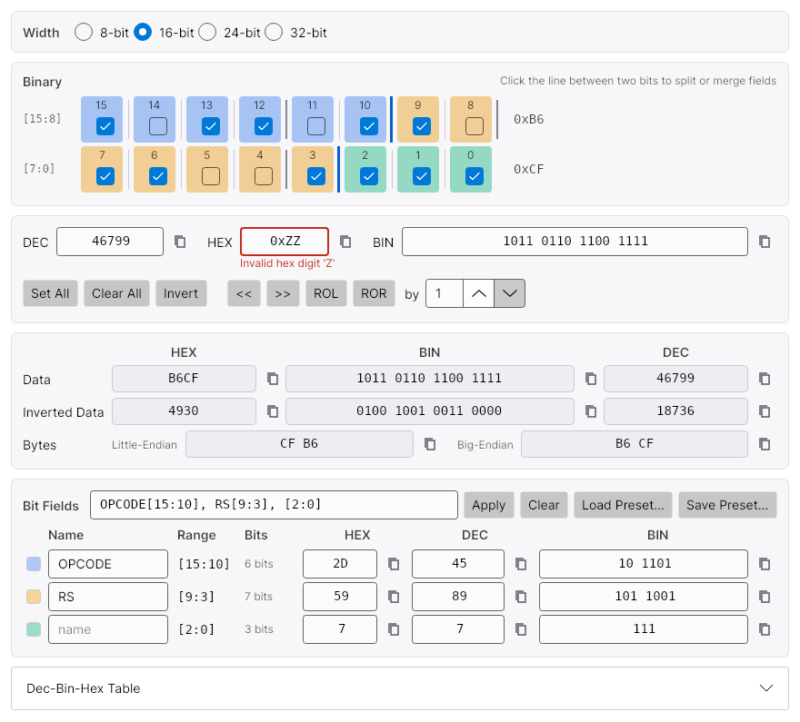
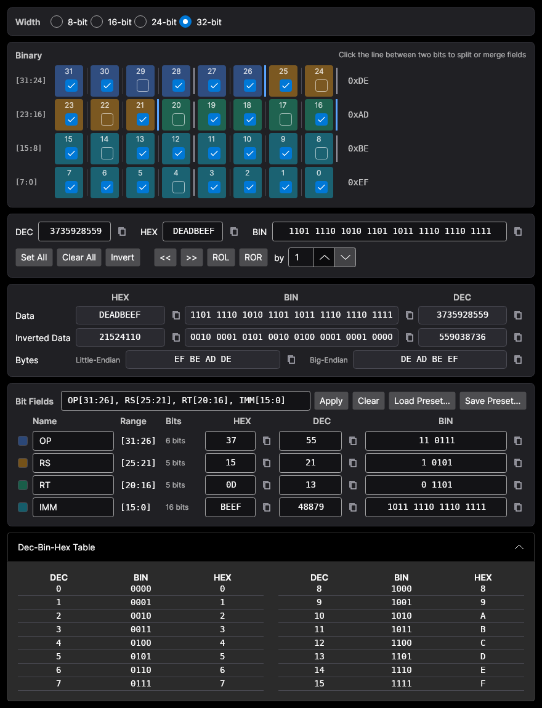

# Bits Converter

A cross-platform bit / binary converter for 8, 16, 24 and 32-bit values, with user-defined bit fields.
Built with [Avalonia](https://avaloniaui.net/) on .NET 8. Successor of the WPF
[Binary-Converter](https://github.com/Leo0862/Binary-Converter) (1-byte only).




## Features

- **Width**: 8 / 16 / 24 / 32-bit. Switching keeps the value (zero-extend or truncate).
- **Bit grid**: one row per byte, MSB first; click a checkbox to toggle a bit.
- **Inputs**: DEC, HEX (`0x` optional) and BIN (`0b` optional). `_` and spaces are ignored.
  Invalid or out-of-range input gets a red border and leaves the value unchanged.
- **Operations**: Set All, Clear All, Invert, logical shift `<<` / `>>`, rotate ROL / ROR by N bits.
- **Data view**: value and inverted value as HEX / BIN / DEC, and the byte array in little / big endian.
  Every value has a copy button.
- **Bit fields**: split the value into fields such as `[15:10] [9:3] [2:0]`.
  Each field shows its own HEX / DEC / BIN, and editing a field writes it back into the value.
- **Presets**: save / load field layouts as JSON. The last session (width, value, fields) is restored on start.
- Light / dark theme follows the system.

## Defining bit fields

Either click the line between two bits in the grid (click again to merge), or type a layout and press **Apply**:

```
OPCODE[15:10], RS[9:3], [2:0]
```

Accepted item forms, separated by `,` `;` or new lines: `15:10`, `[15:10]`, `7`, `NAME[15:10]`, `NAME=15:10`.
Fields must not overlap; bits not covered by a field are listed as *unassigned*.
When the width is reduced, fields above it are kept but marked *out of range*.

Preset file format:

```json
{
  "width": 16,
  "fields": [
    { "name": "OPCODE", "msb": 15, "lsb": 10 },
    { "name": "RS", "msb": 9, "lsb": 3 },
    { "name": "", "msb": 2, "lsb": 0 }
  ]
}
```

## Build

Requires the [.NET 8 SDK](https://dotnet.microsoft.com/download/dotnet/8.0).

```sh
dotnet run --project src/BitsConverter          # run
dotnet test                                     # unit tests
dotnet publish src/BitsConverter -c Release -r win-x64 --self-contained -p:PublishSingleFile=true
```

Other runtime identifiers: `linux-x64`, `osx-x64`, `osx-arm64`.
Pre-built single-file executables are produced by the GitHub Actions workflow (see the run's artifacts, or Releases for `v*` tags).

## Project layout

| Path | Content |
|---|---|
| `src/BitsConverter.Core` | Pure logic: bit math, parsing / formatting, field layout, presets |
| `src/BitsConverter` | Avalonia app (MVVM with CommunityToolkit.Mvvm) |
| `tests/BitsConverter.Core.Tests` | xUnit tests for the core logic |
| `tests/BitsConverter.Tests` | Headless Avalonia tests for the view models |
| `docs/SPEC.md` | Specification (Traditional Chinese) |

## License

[MIT](LICENSE.txt)
